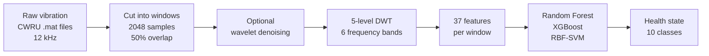

# WAVELET-FEATURE-BASED-BEARING-FAULT-DIAGNOSIS-FOR-PREDICTIVE-MAINTENANCE
# Wavelet-Based Bearing Fault Diagnosis for Predictive Maintenance

**Detecting a failing machine bearing from its vibration, before it breaks, using wavelets and machine learning.**


---

## TL;DR

- **What it does:** listens to the vibration of a motor and tells you whether its bearing is healthy, and if not, *where* the fault is (inner race, ball, or outer race) and *how big* it is (3 sizes). That is 10 possible health states.
- **How:** splits the vibration signal into frequency bands using the Discrete Wavelet Transform (DWT), summarises each band with 37 numbers, and feeds those to a Random Forest / XGBoost / SVM classifier.
- **Result:** **99.1% accuracy** on data from a motor load the model never saw during training. It trains in seconds on an ordinary CPU, and it can show *which frequency bands* it relied on.

---

## The problem, in plain English

Bearings are the small rotating parts that let motor shafts spin smoothly. They are among the most common reasons industrial machines fail unexpectedly, and unplanned breakdowns are expensive.

A damaged bearing makes tiny, repeated "clicks" every time a rolling part hits the damaged spot. These clicks are very short and very faint, buried in normal machine noise. Instead of servicing machines on a fixed schedule (**preventive** maintenance), we want to detect the damage from the machine's own vibration and act only when needed (**predictive** maintenance).

**Why the usual tools struggle:** The standard way to analyse a signal's frequencies (the Fourier transform) tells you *which* frequencies are present but not *when* they happen, so short clicks get smeared out. Wavelets fix this by looking at the signal at several zoom levels at once: very short windows for fast clicks, long windows for slow trends.

## What this project does

Think of an audio equalizer that splits music into bass, mid and treble bands. We do the same to the vibration signal, splitting it into **6 frequency bands**. We then measure how strong and how "spiky" each band is. A healthy bearing and a faulty one produce clearly different patterns across those bands, and a classifier learns to tell them apart.

We deliberately test the model on a **motor load it has never seen** (train on 0, 1, 2 hp, test on 3 hp). This avoids a common trap where results look great only because near-identical data was in both the training and test sets.

---

## Results at a glance

| Question | Answer |
|---|---|
| How accurate is it on an unseen load? | **99.1%** (Random Forest, macro F1 0.991) |
| Is the wavelet step worth it? | Yes: error drops from **3.3% → 0.9%** versus simple time-domain features |
| Which frequencies matter most? | The **high-frequency bands (1.5-6 kHz)**, about 58% of the model's total feature importance |
| Which faults are hardest to tell apart? | Ball faults, and the medium (0.014 in) outer-race fault |
| How fast is it? | Trains in seconds on a CPU. No GPU needed |

Seven of the ten health states were classified with **zero errors** on the unseen load.

---

## How it works



1. **Windowing:** each long recording is cut into short snippets (2048 samples ≈ 0.17 s), overlapping by half. Each snippet inherits the label of its recording.
2. **Denoising (optional):** soft wavelet thresholding removes small noisy coefficients.
3. **Wavelet decomposition:** a 5-level DWT splits each snippet into one low-frequency band (cA5) and five detail bands (cD5 to cD1).
4. **Feature extraction:** 37 numbers describe each snippet (see below).
5. **Classification:** three classifiers are trained and compared.
6. **Evaluation:** tested on a held-out motor load; also tested by leaving each of the four loads out in turn.

---

## Dataset

[CWRU Bearing Data Center](https://engineering.case.edu/bearingdatacenter) (Case Western Reserve University): a public benchmark where bearings were deliberately damaged in a controlled way and run on a test motor while vibration was recorded.

- **Signal used:** drive-end accelerometer, 12 kHz sampling, motor loads 0-3 hp (about 1797-1730 rpm)
- **10 classes:** Normal, plus **Inner Race (IR)**, **Ball**, and **Outer Race (OR)** faults, each at three damage sizes: 0.007, 0.014 and 0.021 inch (about 0.18, 0.36 and 0.53 mm)
- **Note:** the normal-condition files are recorded at 48 kHz, so they are down-sampled by 4 to 12 kHz to match the rest.

| Item | Value |
|---|---|
| Classes | 10 |
| Window length / step | 2048 / 1024 samples |
| Total windows | 4643 |
| Training windows (0, 1, 2 hp) | 3465 |
| Test windows (3 hp) | 1178 |

---

# Technical details (for engineers)

### Sub-bands (fs = 12 kHz, 5-level DWT)

| Band | Frequency range |
|---|---|
| cA5 | 0 - 187.5 Hz |
| cD5 | 187.5 - 375 Hz |
| cD4 | 375 - 750 Hz |
| cD3 | 0.75 - 1.5 kHz |
| cD2 | 1.5 - 3 kHz |
| cD1 | 3 - 6 kHz |

Bearing impacts excite structural resonances at higher frequencies, so cD1-cD3 are expected to carry most of the fault information.

### Features (37 per window)

| Group | Count | Details |
|---|---|---|
| Relative sub-band energy | 6 | energy of each band ÷ total energy |
| Per-band statistics | 30 | mean absolute value, std, kurtosis, skewness, peak × 6 bands |
| Wavelet entropy | 1 | entropy of the relative energy distribution |

A baseline of **8 time-domain features** is used for comparison: mean, std, RMS, peak, kurtosis, skewness, crest factor, impulse factor.

### Models and tuning

| Model | Tuned settings (load-grouped CV, training loads only) |
|---|---|
| Random Forest | 300 trees, `max_depth=None`, `min_samples_leaf=3` |
| XGBoost | 300 rounds, `max_depth=4`, `learning_rate=0.05` |
| RBF-SVM (standardised inputs) | `C=1`, `gamma=0.01` |

Hyper-parameters were chosen with **GroupKFold grouped by motor load** (scoring: macro F1), and the test load was never used for tuning. Search grids are in `tune_models()` in the code.

### Evaluation protocol

- **Main split:** train on loads 0, 1, 2 hp → test on 3 hp.
- **Leave-one-load-out (LOLO):** each of the 4 loads is held out in turn; mean ± std reported.
- **Why not a random split?** Overlapping windows from the same recording are almost identical, so a random split can leak near-duplicates into the test set. Splitting by load avoids this.
- **Metrics:** accuracy, macro F1, per-class report, confusion matrix, feature importance.

---

## Full results

### Held-out 3 hp load

| Classifier | Features | Accuracy | Macro F1 |
|---|---|---|---|
| Random Forest | Wavelet (37) | **99.1%** | 0.991 |
| RBF-SVM | Wavelet (37) | **99.1%** | 0.991 |
| XGBoost | Wavelet (37) | 97.9% | 0.979 |
| Random Forest | Time-domain only (8) | 96.7% | 0.967 |

### Leave-one-load-out (mean ± std across 4 loads)

| Classifier | Accuracy |
|---|---|
| Random Forest | **97.9 ± 2.5%** (most stable) |
| XGBoost | 95.9 ± 4.8% |
| RBF-SVM | 94.0 ± 6.0% |

Random Forest ranges from 93.6% (0 hp held out) to 99.9% (2 hp held out); the SVM drops to 84.9% when 0 hp is held out.

### Effect of the mother wavelet (Random Forest, 3 hp)

| Wavelet | Wavelet features only | Time + wavelet features |
|---|---|---|
| Haar | 96.9% | 95.3% |
| db2 | 98.4% | 98.3% |
| db4 *(default)* | 99.1% | 98.6% |
| db8 | 99.8% | 99.2% |

### Per-class performance

- **Perfect (F1 = 1.000):** Normal, all three inner-race sizes, outer-race 0.007 in and 0.021 in.
- **Hardest:** OR_014 (F1 0.956), Ball_014 (0.975), Ball_021 (0.979).
- All errors involve ball faults or the 0.014 in outer-race fault: 10 of 118 OR_014 windows were predicted as ball faults, and one Ball_007 window was predicted as Ball_021.

### Which frequency bands matter (Random Forest importance)

cD2 ≈ 0.34 · cD1 ≈ 0.24 · cD4 ≈ 0.18 · cD3 ≈ 0.13 · cD5 ≈ 0.10 · cA5 ≈ 0.004

The most important single features are `std_cD2`, `mav_cD2`, `mav_cD1`, `std_cD1` and `kurt_cD2`. This matches the physics: bearing impacts show up in the high-frequency detail bands.

---

## How to read these results honestly

- **99.1% is one split.** The leave-one-load-out average (97.9% for Random Forest) is the more cautious figure.
- **Model selection used the test split.** The "best" model was picked by test accuracy, and Random Forest and SVM tie at 99.1%.
- **db4 vs db8.** db4 is the default used for headline numbers. db8 scored higher (99.8%) in the ablation, a gap of about 9 of 1178 test windows.
- **Wavelet features alone were enough.** Adding time-domain features on top did not improve accuracy.
- **A random 70/30 split gave 99.4%** versus 99.1% cross-load, so leakage had only a small effect for tree models on this dataset.

---

## Quick start (reproduce the results)

The code was developed in **Google Colab** (Python, PyWavelets, scikit-learn, XGBoost). The full cell-by-cell code is in Appendix A of the project report.

**1. Install dependencies**

```bash
pip install PyWavelets xgboost numpy scipy pandas matplotlib seaborn scikit-learn joblib
```

**2. Get the data**

Put the 40 CWRU `.mat` files in a folder called `cwru/`, named by file number (for example `105.mat`). Cell 2 tries to download them automatically and prints `missing <n>` for any that fail; upload those manually.

| Class | File numbers (0, 1, 2, 3 hp) |
|---|---|
| Normal | 97, 98, 99, 100 |
| IR_007 / IR_014 / IR_021 | 105-108 / 169-172 / 209-212 |
| Ball_007 / Ball_014 / Ball_021 | 118-121 / 185-188 / 222-225 |
| OR_007 / OR_014 / OR_021 | 130-133 / 197-200 / 234-237 |

**3. Run the cells in order**

| Cell | What it does | Produces |
|---|---|---|
| 1 | Imports and configuration | |
| 2 | File map, loading, windowing | |
| 3 | Denoising and feature extraction | |
| 4 | Models and load-grouped tuning | |
| 5 | Build the dataset | Table 2 |
| 6 | Tune and evaluate on 3 hp | Table 3 |
| 7 | Leave-one-load-out and random-split comparison | LOLO numbers |
| 8 | Per-class report and confusion matrix | Table 4, Figure 3 |
| 9 | Wavelet and feature-set ablation | Table 5 |
| 10 | Feature importance and model saving | Figure 4, `bearing_rf.pkl` |
| 11 | FT vs STFT vs DWT demonstration | comparison plot |

Outputs are saved to `results/`: `fig3_confusion_matrix.png`, `fig4_feature_importance.png`, `bearing_rf.pkl`.

### Configuration (Cell 1)

| Variable | Default | Meaning |
|---|---|---|
| `WAVELET` | `"db4"` | mother wavelet (`haar`, `db2`, `db4`, `db8`) |
| `LEVEL` | `5` | DWT decomposition level |
| `WIN`, `STEP` | `2048`, `1024` | window length and hop |
| `DENOISE` | `False` | soft-threshold denoising on/off |
| `TUNE` | `True` | run load-grouped grid search |
| `TEST_LOAD` | `3` | held-out motor load (hp) |
| `SEED` | `42` | random seed |

---

## Project structure

```
.
├── cwru/                          # CWRU .mat files (40 files, not included)
├── results/                       # generated figures and saved model
├── ADSP_Mini_Project_Report.pdf   # full report with code appendix
└── README.md
```

---

## Glossary

| Term | Plain-English meaning |
|---|---|
| **Bearing** | A part that lets a shaft spin smoothly with little friction |
| **Predictive maintenance** | Repairing a machine when its condition says it needs it, rather than on a fixed schedule |
| **Vibration signal** | The shaking of the machine measured by a sensor (accelerometer) |
| **Fourier transform (FT)** | Shows which frequencies are in a signal, but not when they occur |
| **Wavelet / DWT** | A way to analyse a signal at several zoom levels, keeping both timing and frequency information |
| **Sub-band** | One slice of the frequency range (like bass or treble on an equalizer) |
| **Mother wavelet (Haar, db4...)** | The basic wave shape used for the analysis; Daubechies (db) wavelets are smoother than Haar |
| **Window** | A short snippet cut from a long recording |
| **Kurtosis** | A measure of how "spiky" a signal is, useful for detecting sharp impacts |
| **Entropy** | How evenly energy is spread across the bands |
| **Random Forest / XGBoost** | Classifiers that combine many small decision trees into one stronger decision |
| **SVM** | A classifier that separates classes with a boundary in feature space |
| **Macro F1** | An accuracy score that treats all classes equally, so rare classes are not ignored |
| **Cross-load testing** | Testing on a motor load that was never used in training, a stricter and more honest test |
| **Feature importance** | A score showing which inputs the model relied on most |
| **Inner race / outer race / ball** | The three places a bearing can be damaged |

---

## Limitations

- CWRU is a **laboratory** dataset with deliberately seeded faults. Real machines are noisier and faults develop gradually, so results may not transfer without adaptation.
- A fixed mother wavelet and decomposition level are assumed.
- Results are from a single test load plus leave-one-load-out; no other dataset was tested.

## Future work

- Wavelet packet decomposition with automatic selection of informative sub-bands
- Envelope analysis, and a comparison with a 1-D CNN or scalogram CNN on the same split
- Testing on other datasets (for example Paderborn) and under added noise
- Embedded deployment for real-time monitoring, plus remaining-useful-life estimation

---

## Team

| Shrutik Acharya
| Siddhaant Pandit 
| Soham Bhosale


## References

1. Case Western Reserve University Bearing Data Center. <https://engineering.case.edu/bearingdatacenter>
2. W. A. Smith and R. B. Randall, "Rolling element bearing diagnostics using the Case Western Reserve University data: A benchmark study," *Mechanical Systems and Signal Processing*, vol. 64-65, pp. 100-131, 2015.
3. S. G. Mallat, "A theory for multiresolution signal decomposition: the wavelet representation," *IEEE Trans. PAMI*, vol. 11, no. 7, pp. 674-693, 1989.
4. I. Daubechies, *Ten Lectures on Wavelets*, SIAM, 1992.
5. Y. Lei et al., "Applications of machine learning to machine fault diagnosis: A review and roadmap," *Mechanical Systems and Signal Processing*, vol. 138, 2020.
6. L. Breiman, "Random forests," *Machine Learning*, vol. 45, pp. 5-32, 2001; T. Chen and C. Guestrin, "XGBoost: A scalable tree boosting system," *Proc. ACM KDD*, pp. 785-794, 2016.
7. R. M. Rao and A. S. Bopardikar, *Wavelet Transforms: Introduction to Theory and Applications*, Pearson Education, 2000.
8. J. G. Proakis and D. G. Manolakis, *Digital Signal Processing*, PHI, 2014.

## License
